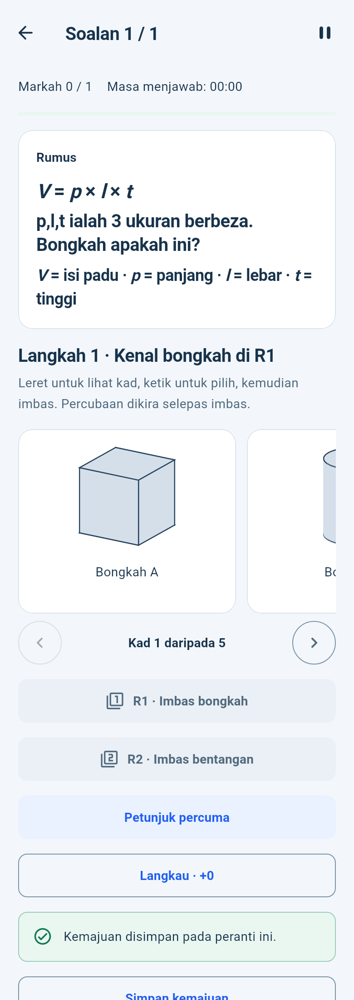
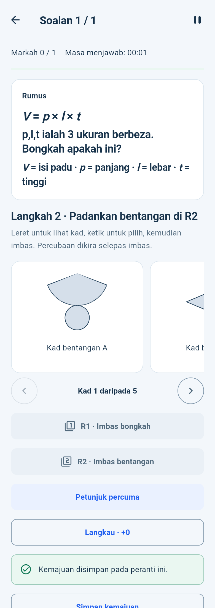
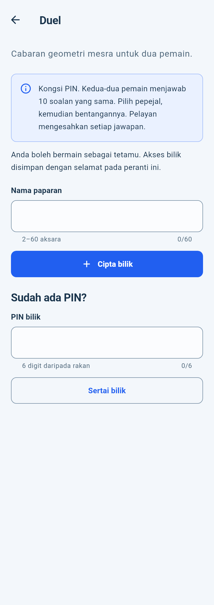
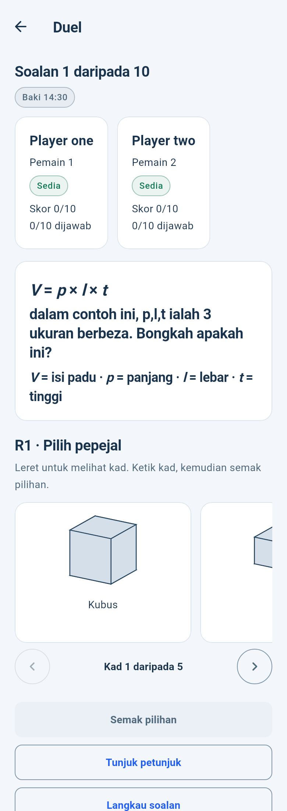
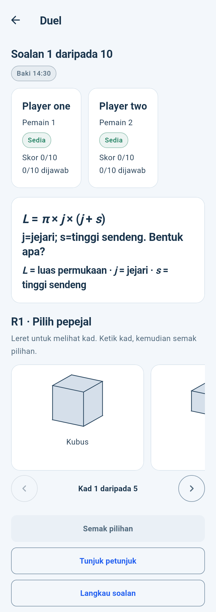
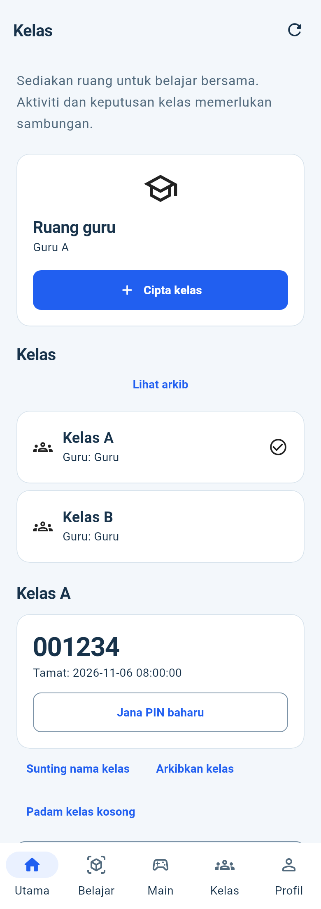
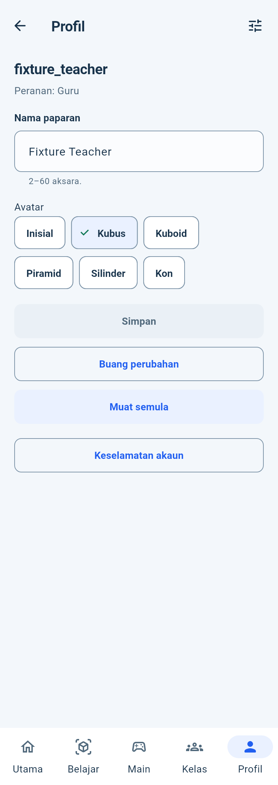

# Host-rendered implementation previews

6 November 2026. These are actual Flutter widgets rendered by the host test engine, **not Android screenshots**. The first two use the real offline Solo engine/SQLite; the Duel entry uses configured production guest services. Active Duel, teacher Kelas and signed-in Profil use the labelled transport/gateway fixtures from the tests. No real room/account/profile write was made.

The host-only adapter loads Roboto/MaterialIcons and replaces the test engine Ahem font fallback. App colors, layout, widgets and feature controllers are unchanged. Captures use390×1100dp and BM/light/100%; 320dp/150% cases are covered separately by widget tests.

## 01-host-solo-solid-math-ms

## 02-host-solo-net-ms

## 03-host-duel-entry-ms

## 04-host-duel-active_B2-fixture-ms

## 04-host-duel-active_C2-fixture-ms

## 05-host-classroom-teacher-fixture-ms

## 06-host-profile-editor-fixture-ms

## Reproduce

The opt-in [capture source](updates/2026-11-06/evidence/capture_duel_refresh.dart.txt) is outside normal test discovery. From the app directory, copy it to `host_capture/capture_duel_refresh.dart`, supply the same ignored public configuration and run the recorded Flutter test command. Its relative imports intentionally reuse the labelled test fixtures. Remove that temporary directory afterward. This file is never linked into the production APK.
