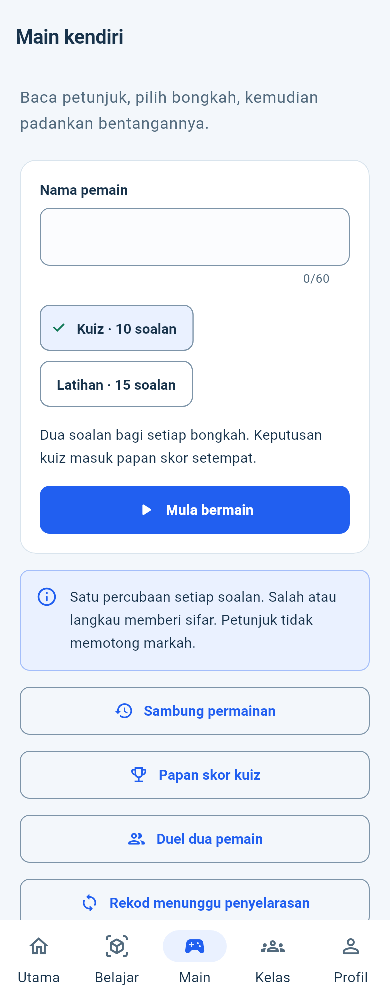
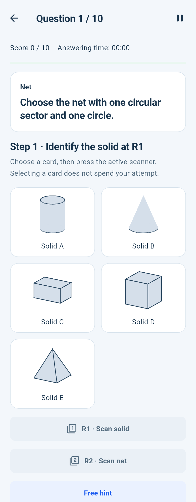
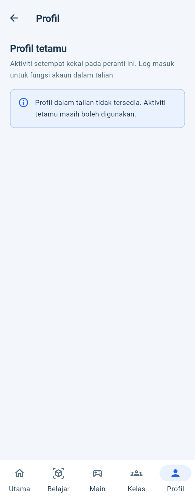

# GeoMath widget previews

Actual Flutter widget code rendered by the host engine, using a capture-only Roboto font override. **These are not Android screenshots.** Device execution remains blocked as documented in LATEST.md.

## Play · BM · light ·100%

## Play · English · dark ·150%

## Native Solo question · English · light

## Guest profile · BM · light

