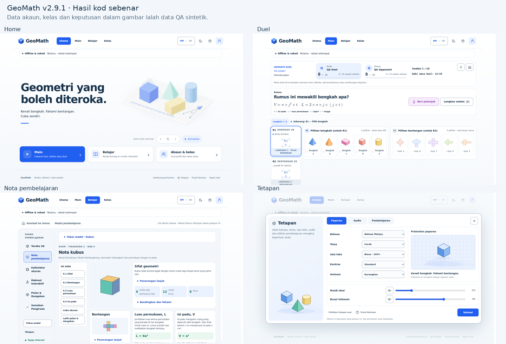

# GeoMath · pelaksanaan mockup 40 paparan

Calon semakan **Digital v2.9.1 / modul v1.6.2** pada branch
`digitalized-ux-mockup-completion`. Asas: `ef697c86a5bfdf5a5658c3df92bce1d7f3f88652`.
Rujukan reka bentuk: [konsep asal](https://github.com/unDead41/geodecoder/tree/4d83561667cf74fbe5cd6144ce5e3e7f660a75cd/digital/docs/uiux-redesign-concept).

Versi 2.9.0 sebelum ini menggabungkan fungsi dan sebahagian kemasan UI; ia belum
melengkapkan komposisi semua 40 paparan. Perubahan ini melengkapkan pemilik view
sebenar, ilustrasi, rel navigasi, pentas R1/R2, nota, makmal dan utility.

## Bukti dan pengesahan

- [Liputan 40 paparan dan perbezaan terkawal](COVERAGE.md).
- [Perbandingan 10 papan asal/hasil kod](evidence/comparison/README.md).
- [Bukti desktop](evidence/desktop/REVIEW.md) dan [telefon](evidence/mobile/REVIEW.md).
- [Pengesahan dan batas bukti](VERIFICATION.md).
- [Handoff integrasi dan prompt sambungan](HANDOFF.md).

Semua gambar hasil kod sebenar. Akaun, nama, kelas, rekod dan keputusan berlabel QA
ialah data sintetik dalam pangkalan data sementara. Gambar bukan bukti pencapaian
murid atau bukti sambungan backend hosted. Fail fixture tidak termasuk dalam
produk yang dibina. Geometri dan controller sebenar kekal digunakan.

## Perubahan utama

Home mengekalkan set geometri 3D, tajuk navy dan tiga tindakan utama. Kuiz/latihan
menggunakan pentas R1/R2, soalan di sisi dan dua bank lengkap lima kad. Pembetulan
membandingkan pilihan dengan jawapan sebenar; keputusan menggunakan data semasa.
Duel mempunyai jalur status padat, bank bongkah/bentangan sebelah menyebelah dan
satu paparan keputusan. Akaun/kelas berkongsi rel navigasi sebenar. Tetapan
mempunyai tab paparan/audio/pembelajaran; bantuan dan laporan kekal menggunakan
aliran dialog serta salinan laporan tempatan yang sebenar.

Modul mempunyai konteks yang lebih padat, nota berilustrasi dengan isi kandungan
dan penjelasan lanjut, serta pentas makmal yang cepat kelihatan. Semua 11 bongkah,
mod lanjutan, Kaedah1 pelan/dongakan dan Ramal→Cuba→Semak→Terangkan dikekalkan.

## Status penerbitan

Ini hasil semakan branch private. `main`, `main-digitalized`, branch ciri lain,
mirror awam, Pages, Auth/SMTP dan backend hosted tidak diubah oleh kerja ini.
Pages terdahulu masih keluaran awam v2.8.0; push branch ini tidak menerbitkannya.
Keperluan rollout offline/scaling daripada integrasi 2.9.0 masih terpakai.
