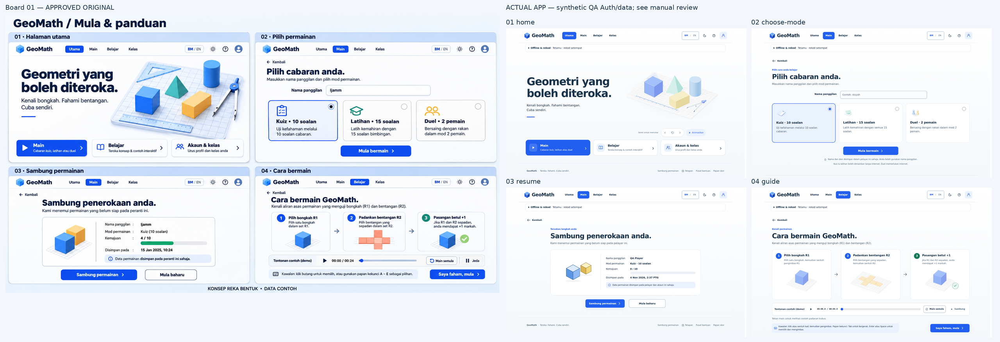
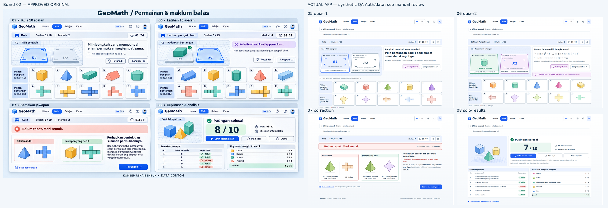
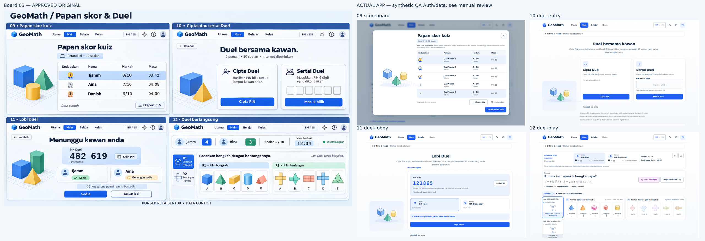
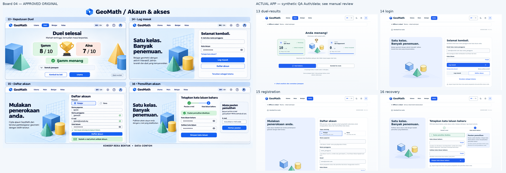
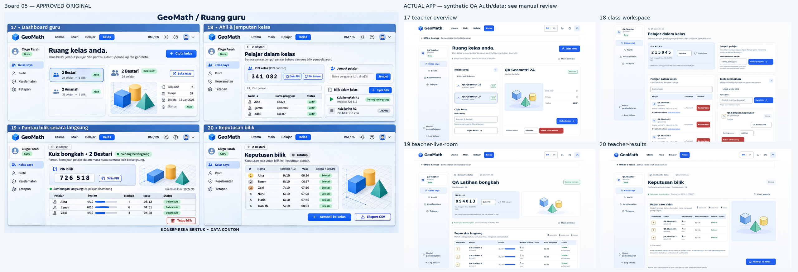
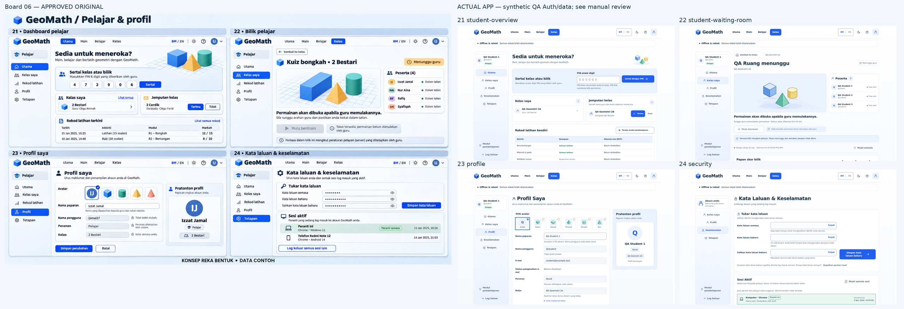
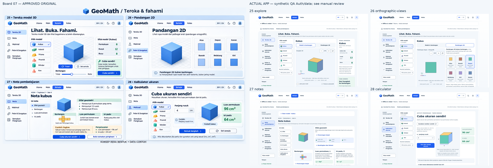
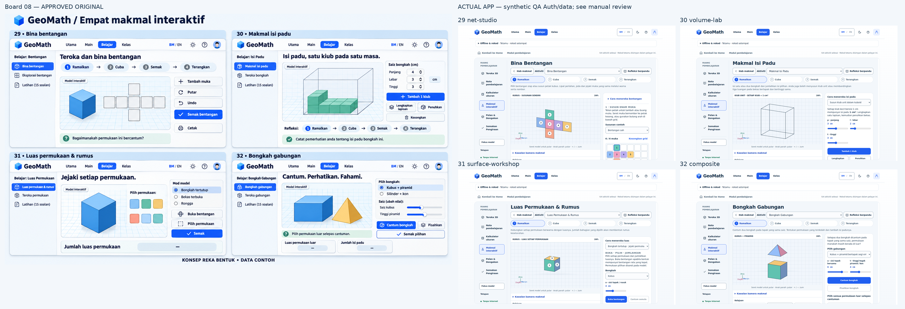
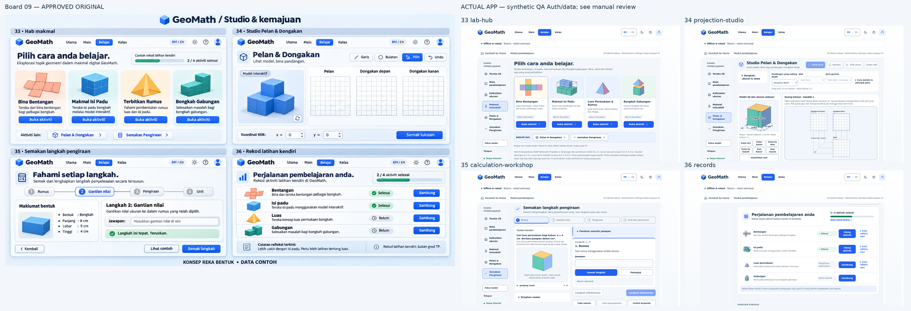
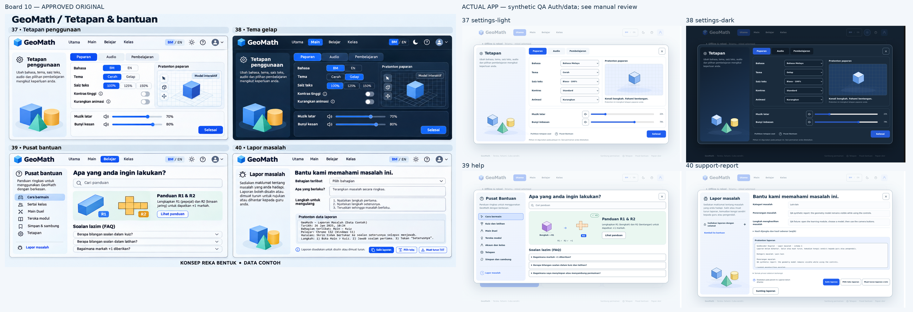

# Perbandingan konsep dan hasil kod

Papan perbandingan ini dikecilkan kepada lebar 2560px untuk paparan. Screenshot desktop 1440×900 asal kekal dalam folder [desktop](../desktop/REVIEW.md); mockup asal dirujuk pada commit konsep.

Kiri: mockup asal yang diluluskan. Kanan: screenshot aplikasi sebenar menggunakan data QA sintetik. Perbezaan fungsi/geometri yang dikawal dinyatakan dalam COVERAGE.md dan ulasan setiap paparan.

