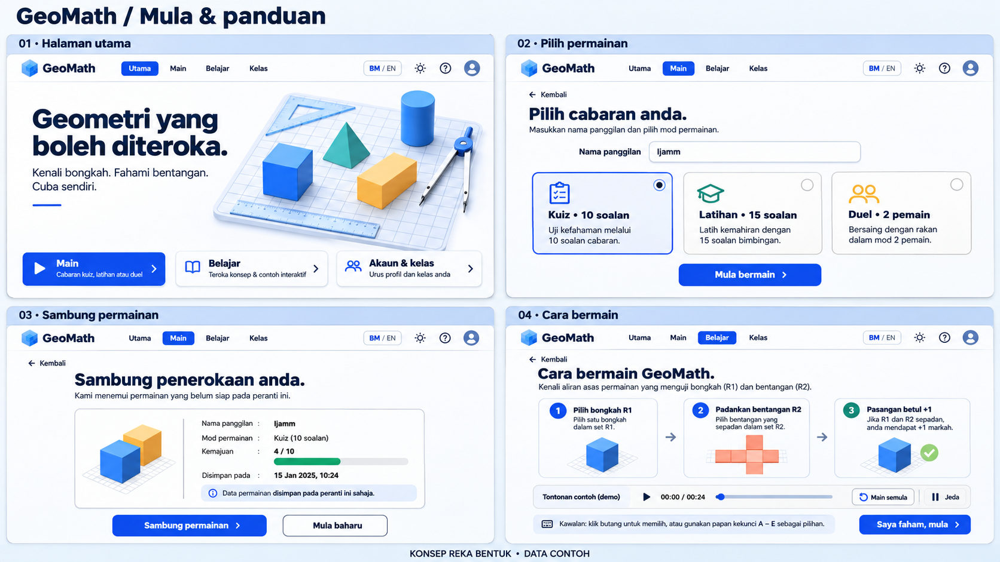
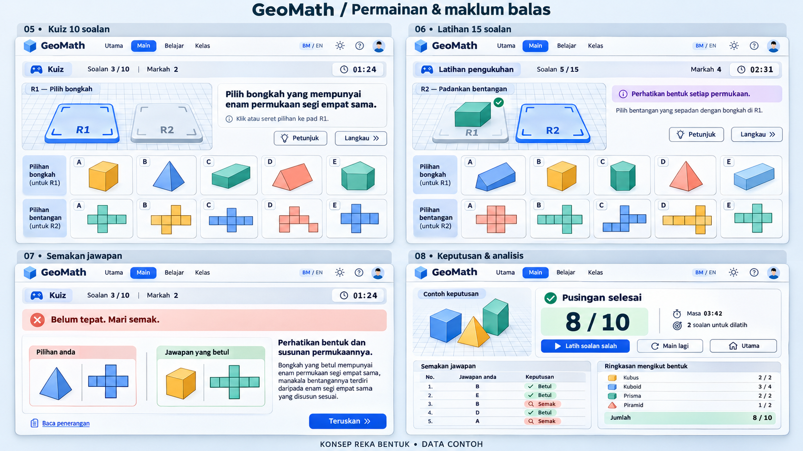
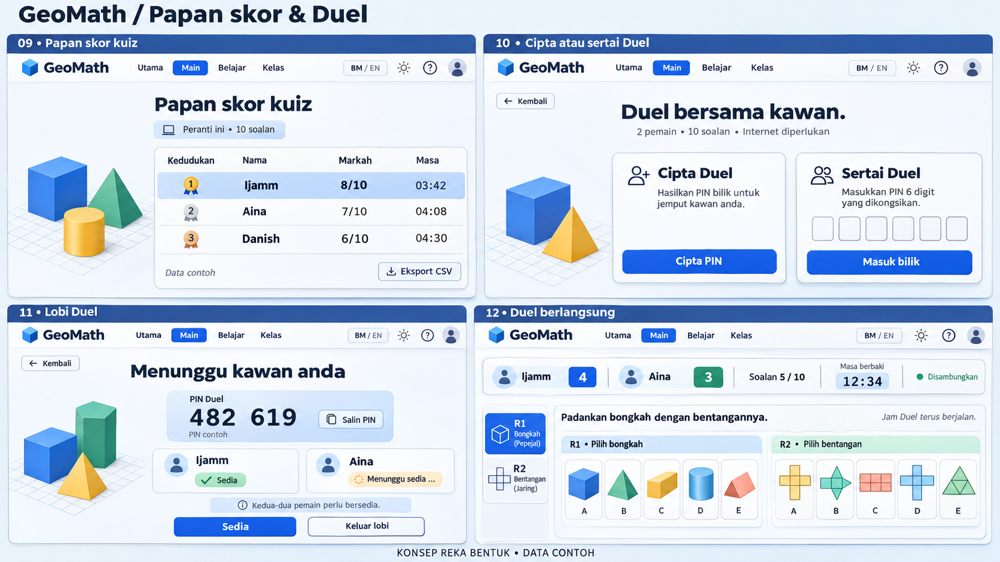
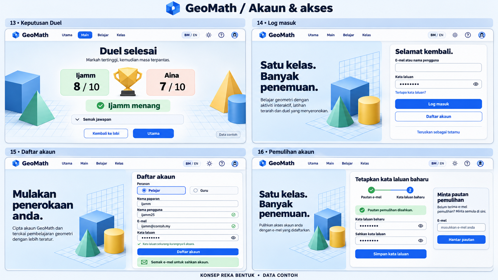
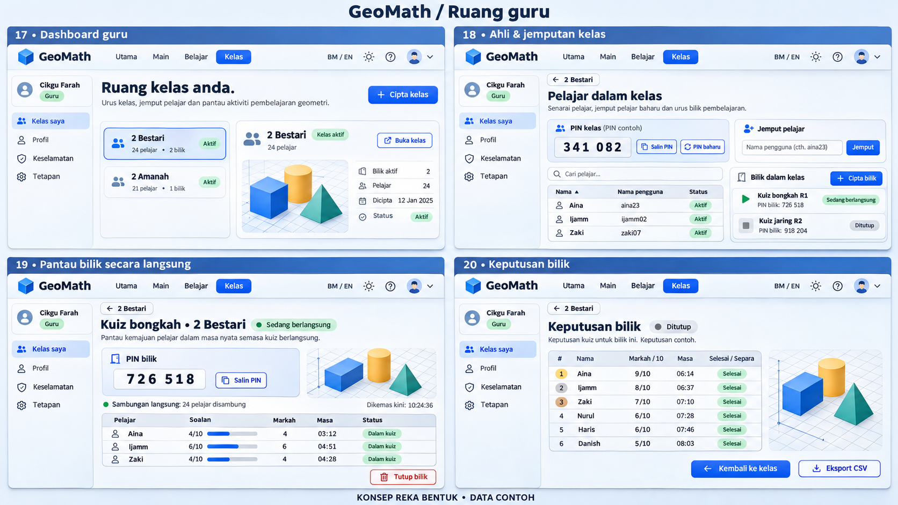
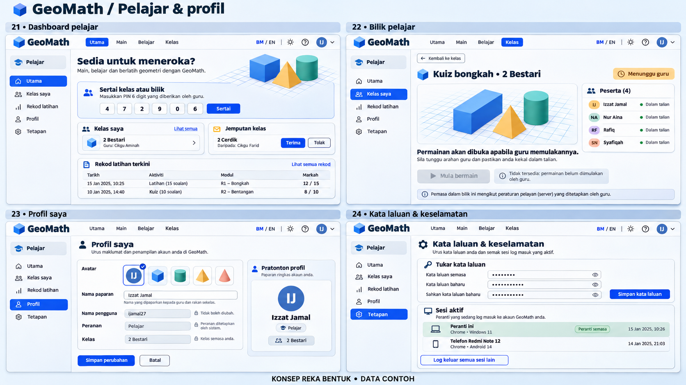
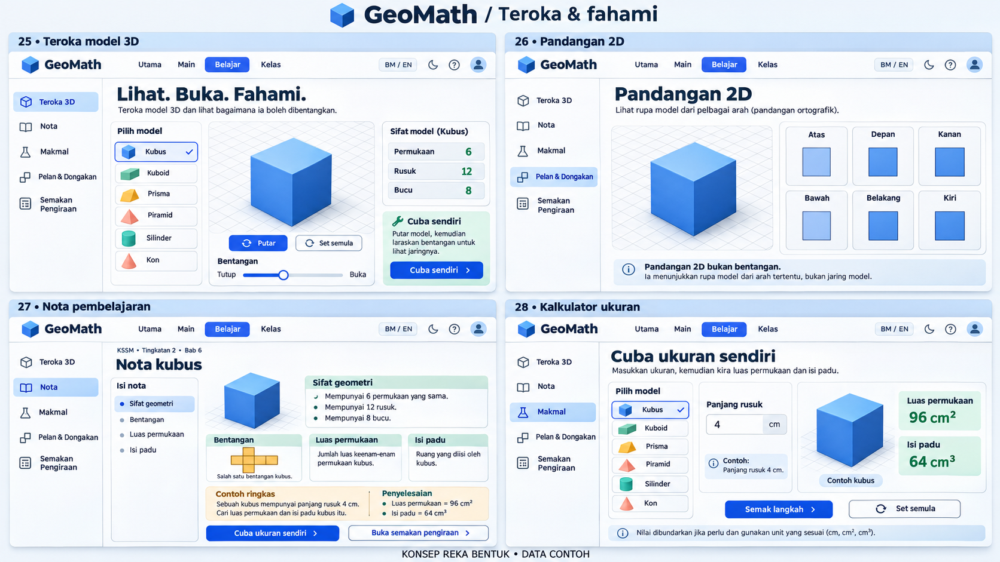
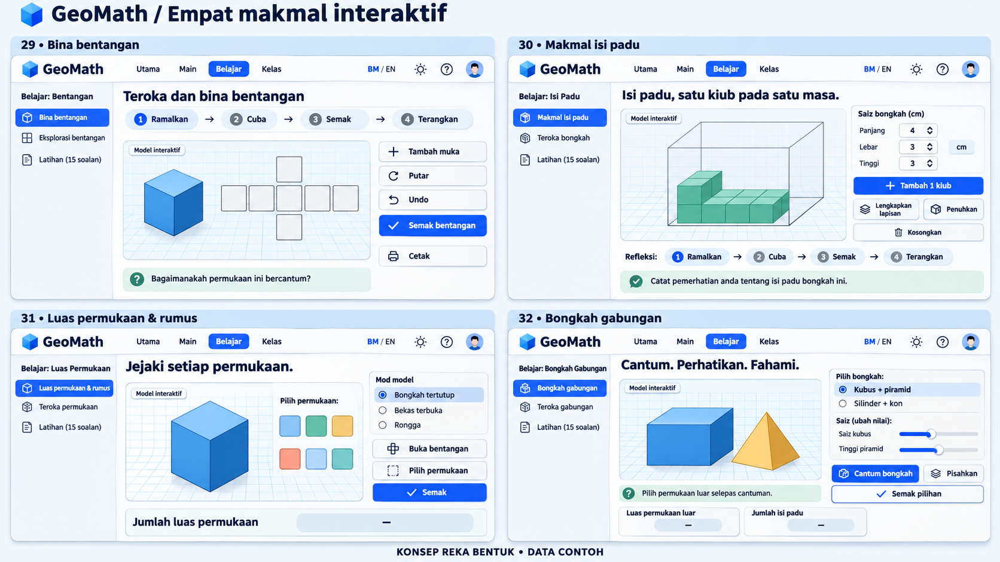
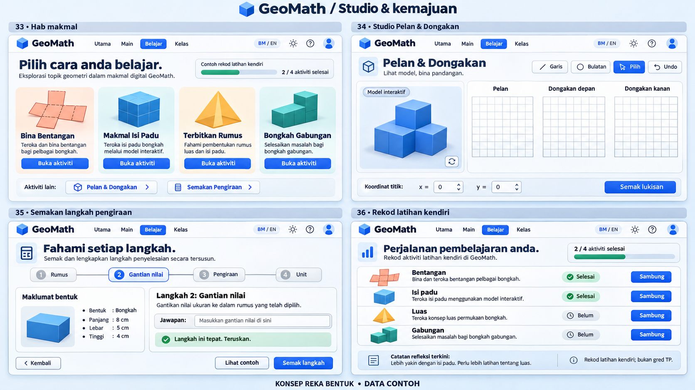
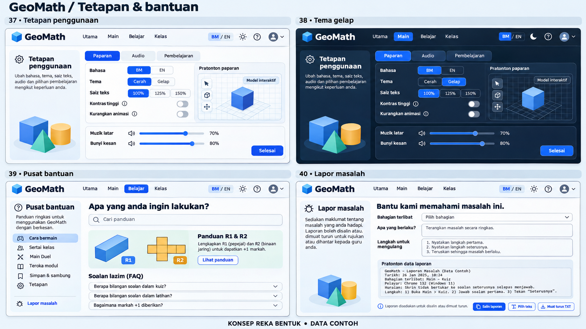

# GeoMath UI/UX redesign concept

Versi konsep: **1.0.0** · 4 November 2026 (Asia/Kuala_Lumpur).

Pakej ini menyimpan **10 gambar asal, 40 paparan konsep** dan empat prompt pelaksanaan. Ia ialah rujukan visual untuk reka bentuk GeoMath berasaskan GeoDecoder; bukan keluaran aplikasi, sumber formula, data pengguna atau bukti deployment.

- Repository: `unDead41/geodecoder`.
- Branch konsep: `ui/ux-redesign-concept`; label pengguna “ui/ux redesign consept” dinormalkan kerana nama ref Git tidak menerima ruang.
- Asas Digital: `main-digitalized` pada `391df985eea4fee15d9859e678068b1a3f613cba`.
- Versi sumber ketika semakan: Digital **2.8.0**, modul **1.6.0**. Ini tidak mengesahkan versi production.
- Head `main` yang diperhatikan: `25836eb1a6f24459aace8a3980ae880a13e3b488`.
- Skop commit konsep: gambar, manifest, kontrak, pembahagian kerja dan prompt sahaja.
- Arahan pengguna: **jangan push/merge main dahulu**. Dalam kerja Digital ini, larangan juga meliputi `main-digitalized`, mirror awam dan penerbitan Pages.

Baca [kontrak pelaksanaan](IMPLEMENTATION_CONTRACT.md) dan [pemilikan fail](OWNERSHIP.md) sebelum menggunakan gambar. Rajah, teks kecil, tarikh, keputusan dan beberapa navigasi dalam gambar ialah contoh penjanaan imej; kod dan kontrak semasa menentukan tingkah laku sebenar.

## Indeks gambar

| Gambar | Paparan | Kandungan |
|---|---|---|
| [01](images/01-start-and-guide.png) | 01–04 | Utama, pilihan permainan, sambung, cara bermain |
| [02](images/02-game-and-feedback.png) | 05–08 | Kuiz, latihan, pembetulan, keputusan |
| [03](images/03-scoreboard-and-duel.png) | 09–12 | Papan skor, masuk Duel, lobi, Duel langsung |
| [04](images/04-account-and-duel-result.png) | 13–16 | Keputusan Duel, log masuk, daftar, pemulihan |
| [05](images/05-teacher-workspace.png) | 17–20 | Dashboard guru, ahli kelas, bilik langsung, keputusan |
| [06](images/06-student-and-profile.png) | 21–24 | Dashboard pelajar, bilik, profil, keselamatan |
| [07](images/07-explore-notes-calculator.png) | 25–28 | Teroka 3D, pandangan 2D, nota, kalkulator |
| [08](images/08-interactive-labs.png) | 29–32 | Bentangan, isi padu, luas/rumus, gabungan |
| [09](images/09-studio-and-progress.png) | 33–36 | Hab makmal, Pelan & Dongakan, semakan pengiraan, rekod |
| [10](images/10-settings-and-support.png) | 37–40 | Tetapan, tema gelap, bantuan, laporan masalah |

Setiap PNG asal berukuran **1672 × 941 px**. Tiada dakwaan eksport 4K. [manifest.json](manifest.json) merekodkan saiz byte, dimensi, SHA-256 dan Git blob SHA setiap gambar. Semua imej disalin tanpa perubahan daripada hasil konsep dalam chat.

## Empat chat pelaksanaan

| Chat | Branch kerja sahaja | Prompt |
|---|---|---|
| Duel | `digitalized-game-duel-ui-refresh` | [01-duel-ui-refresh.md](prompts/01-duel-ui-refresh.md) |
| Modul 1 — Teroka, nota, kalkulator | `digitalized-module-explore-ui-refresh` | [02-module-explore-ui-refresh.md](prompts/02-module-explore-ui-refresh.md) |
| Modul 2 — Empat makmal dan hab | `digitalized-module-labs-ui-refresh` | [03-module-labs-ui-refresh.md](prompts/03-module-labs-ui-refresh.md) |
| Modul 3 — Studio, pengiraan, rekod | `digitalized-module-studio-ui-refresh` | [04-module-studio-ui-refresh.md](prompts/04-module-studio-ui-refresh.md) |

Prompt ini ialah tugasan untuk chat berasingan. Pakej ini **tidak** melaksanakan perubahan UI tersebut. Setiap pelaksana mengambil kod daripada `main-digitalized` remote terkini dan membaca konsep melalui ref ini; jangan menggabungkan seluruh branch konsep sebagai asas kod yang lebih lama.

## Galeri

