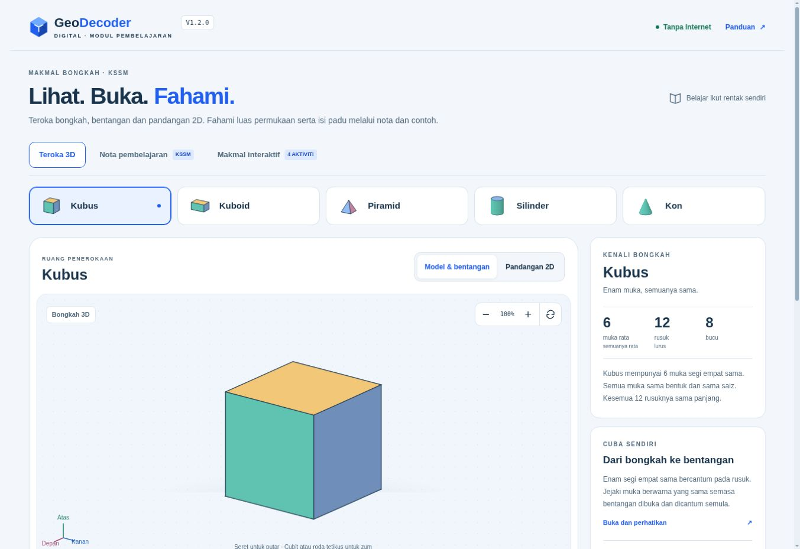
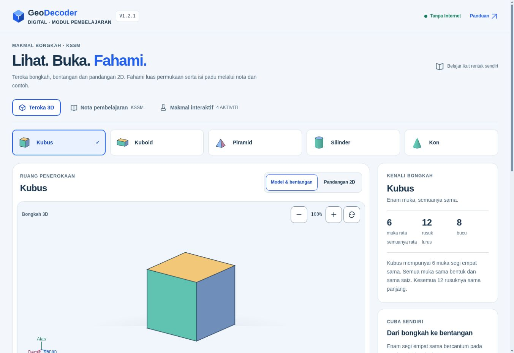
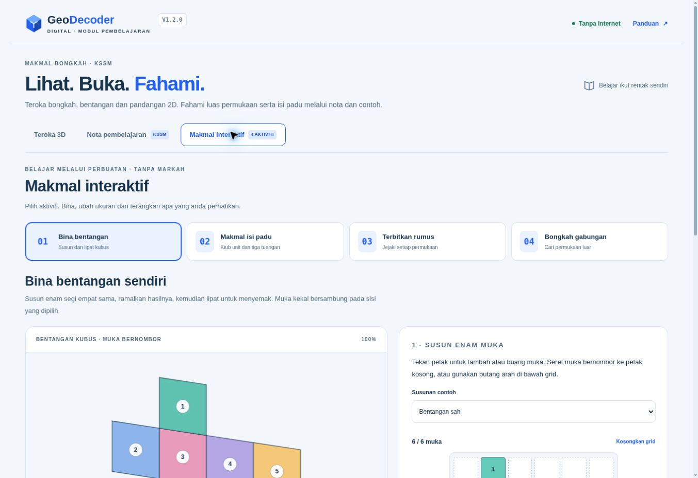
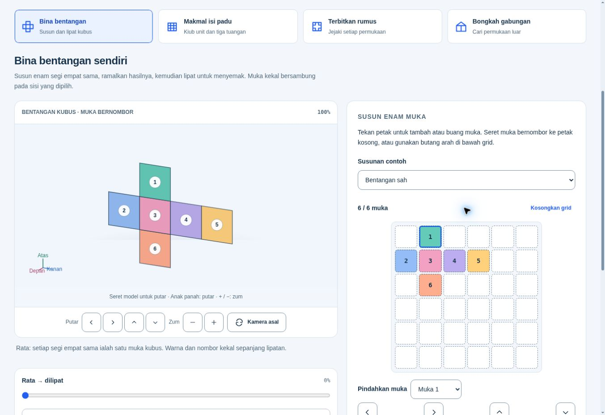

# Pengesahan reka bentuk modul v1.2.1

Tarikh: 26 Oktober 2026, Malaysia. Branch hasil: **digitalize-module-design**.
Asas sebenar `digitalize-module`: **931a0150397bfb3fd79ef3c8da6684167d1c6aad**,
tree **c1ced5c619397170a5bf7e0f601f6bbafed1a52f**, modul v1.2.0.
Main rujukan: **a059979d97926b82cafd4aa5cf3fe59da04a55bb**, firmware v1.1.3.
Ref lain dan audit sebelum perubahan: [pelan](plans/2026-10-26-design-system.md).

Arahan susulan pengguna memindahkan hasil ke branch baharu `digitalize-<nama sesuai>`.
Nama dipilih: `digitalize-module-design`. Tiada perubahan diterbitkan pada main,
sharing, digitalize, main-digital atau digitalize-module. Pada semakan akhir, source modul telah bergerak kepada v1.3.0:
**ee7c7ee983ce32bc9681c60424df184f29e8a80b**. Hasil reka bentuk ini kekal
berasaskan snapshot v1.2.0 yang diaudit dan tidak menimpa kemas kini chat lain.
Fungsi v1.3.0 belum digabung ke branch reka bentuk; lihat
[handoff integrasi](INTEGRATION_HANDOFF_V1_3.md).

## Hasil

- Satu sumber `src/design-system.mjs` untuk warna, keadaan, tipografi, spacing,
  radius, border, shadow, saiz, tempoh gerakan, easing UI dan ikon SVG.
- Build menjana `src/design-tokens.css`; fail itu tidak diedit manual.
  `src/ui.mjs` berkongsi pembinaan DOM/SVG dan persembahan Main/Jeda/Sambung.
- Satu keluarga butang, medan native, pilihan permukaan, panel, rumus, keputusan,
  kamera dan maklum balas. Keadaan hover/fokus/aktif/dipilih/disabled jelas;
  hover tidak menggerakkan sasaran. Ikon SVG 24×24, stroke 1.8px, label BM.
- Teks minimum 12px untuk metadata/kawalan padat, 14px kawalan umum/keterangan dan 16px isi nota.
  Kawalan biasa sekurang-kurangnya 44px tinggi. Sel grid ialah pengecualian
  ruang geometri: sekurang-kurangnya 36px tinggi dengan gap 4px, disertai
  pemilih muka dan butang arah 44px sebagai alternatif.
- Toolbar dan bantuan berada di luar kanvas. Panel responsif menatal secara
  semula jadi; rujukan nota tidak melekat. Model mendapat ruang utama dan
  tindakan **Lihat perubahan pada model** selepas kawalan makmal.
- Jeda membekukan kamera dan kemajuan. Sambung makmal menggunakan masa/easing
  asal; tuangan dijeda tidak boleh memulakan tuangan lain. Tab tersembunyi
  menyimpan sasaran dan memerlukan sambung eksplisit, tanpa hidup sendiri.
- Framing makmal menggunakan rujukan geometri yang tetap sepanjang gerakan;
  cantum/pisah/lipat tidak lagi menukar skala fizikal setiap bingkai.
- HTML keluaran: **173,623 bait**, satu fail mandiri. Badge **V1.2.1** bersebelahan
  logo. Tiada CDN, fon, aset luaran, storan, akaun atau permintaan runtime.

## Sumber matematik dipelihara

Semakan Git blob membuktikan fail ini sama tepat dengan sumber asas:

| Fail | SHA blob |
|---|---|
| src/geometry.mjs | 89c8b5b41308ca0746fb2754bd162fd5ff7da121 |
| src/lab-geometry.mjs | 37aa7bb48a3d401b7bcd2a7e8d46ca17e2f4b765 |
| src/lessons.mjs | 1c2add7ea39d1dd4813ae97dd18d03b952f41807 |
| main/firmware_version.h | 52e556a57dd6195fd0ed1eab139ca2b5598893d2 |
| main/question_bank.h | 6e956f0a264bca7d3bd0fb0e0a4c63f8af9214b2 |

Lima bongkah, nota KSSM/DSKP, sepuluh contoh, empat makmal, ukuran, sambungan,
unjuran dan keputusan asal dikekalkan. Renderer hanya menukar framing; bentangan
masih transformasi geometri tegar/pembangunan permukaan analitik, bukan fade,
pertukaran gambar atau permukaan melengkung berengsel. Kod kuiz, skor, analitik,
backend dan firmware tidak disentuh.

## Keputusan automatik

| Semakan | Keputusan |
|---|---|
| `node tools/build.mjs` | Lulus; HTML mandiri 173,623 bait |
| `node --test tests/*.test.mjs` / `npm test` | **107/107 lulus**, 0 gagal/skipped |
| `node tools/check.mjs` / `npm run check` | Lulus syntax, ID, offline, versi, token dijana, ikon, kontras |
| `python ../../tools/check_version.py` | Lulus; firmware/README/changelog akar kekal v1.1.3 |
| `git diff --check` | Lulus |
| DESIGN.md lint rasmi 0.4.0, CLI terpasang | **0 error**, 5 warning token warna diwarisi yang tidak dirujuk oleh metadata komponen |
| Premium audit strict | **Tidak lulus secara mentah: 63 finding actionless-button**, 0 canonical owner tidak selesai; penjelasan di bawah |

Ujian baharu terlebih dahulu menghasilkan kegagalan bagi kamera selepas Jeda,
tuangan bersaing, sambung yang memulakan easing baharu, kehilangan sasaran ketika
tab tersembunyi, dan skala auto-fit. Semuanya lulus selepas pembaikan. Regresi ikon turut menguji source modular dengan DOM port yang memulangkan null
bagi path yang belum wujud, sebelum hydration. Suite turut
menguji 1,001 bingkai setiap bongkah, ketegaran/jarak/luas/warna muka, enam unjuran,
semua 35 heksomino (11 bentangan kubus sah), isi padu cecair dan pengiraan asal.

**Batas alat audit statik:** parser premium hanya menganggap atribut inline
`onclick` sebagai tindakan. Aplikasi memasang tindakan melalui `addEventListener`
dan `LearningLabs.bind` dalam modul. Kesemua 63 finding ialah aturan sama pada
butang ber-ID; tidak ditutup dengan handler kosong, atribut palsu atau pengecualian
sourceRoots. Ujian `every literal action button has a real shipped-script binding`
membuka bahagian lazy dan mengesahkan binding setiap butang keluaran sebenar.
Aliran pelayar di bawah mengesahkan tindakan utama. Bukti raw dikekalkan; laporan
ini tidak mendakwa audit strict mengembalikan exit 0.

## Pengesahan pelayar sebenar

Cloud Chromium, HTML keluaran sebenar pada preview HTTP dalaman. Preview diasingkan
kepada laluan QA tersendiri selepas preview chat lain bertukar. Tiada Site berdaftar,
penerbitan umum atau perubahan sumber chat lain dibuat; hanya folder fixture QA unik.

Matriks **24 paparan**: Teroka, Nota, Bina Bentangan, Isi Padu, Luas Permukaan dan
Gabungan pada viewport CSS iframe **320 / 390 / 768 / 1280px**. Semuanya tiada
overflow halaman, tiada teks UI di bawah 12px dan tiada kawalan biasa di bawah
44px. Scrollbar 10px kekal kelihatan, jadi availableWidth ialah 310/380/758/1270px.
Jadual nota menatal dalam regionnya sendiri. Ini ujian reflow CSS sebenar;
bukan emulasi perkakasan telefon.

Aliran yang dicuba:

- Lima bongkah: Home/End slider mencapai 0/100%; bentuk/warna/keterangan sesuai.
  Semua enam pilihan ortografik kon, arah model, papan kekunci dan zum.
- Nota lima bongkah: luas/isi padu default 96/64, 108/72, 96/48, 748/1540,
  75.43/37.71. Contoh berpandu, input negatif, output dikosongkan, fokus medan
  salah, reset kepada nombor contoh dan pautan kembali ke model.
- Bentangan: pilihan native melalui klik/keyboard, susunan bertindih dengan
  penjelasan, pindah muka melalui fixture pointer, lipat/jeda/sambung sehingga
  100%, fokus kembali ke model, slider dan kamera.
- Isi padu: tambah satu lapisan + satu kiub = 7/18; penuhkan = 18/18.
  Kon dan piramid masing-masing berjaya tiga tuangan hingga 100%; kon dijeda
  dan disambung, dengan tindakan tuang lain dilumpuhkan. Isi penuh 113.1 cm³
  (silinder) dan 144 cm³ (prisma) untuk ukuran default makmal.
- Luas permukaan: lima bongkah, pilih semua permukaan, jumlah 96/108/96/747.7/75.4
  cm² dan rumus sesuai. Bentangan kon dimainkan sehingga rata.
- Gabungan: kubus+piramid 240 cm² / 264 cm³; pemilihan luar betul menghasilkan
  penjelasan, menambah muka dalaman menghasilkan pembetulan. Silinder+kon
  188.5 cm² / 207.35 cm³. Cantum, slider dan kamera diuji.
- Reduced motion JS fixture: mula tanpa putaran; gerakan hanya selepas tindakan
  eksplisit; Jeda memaparkan Sambung. Dataset mengesahkan reducedMotion=true.

Rekod terperinci: [browser-checks-final.json](../evidence/design-v1.2.1/browser-checks-final.json).

## Screenshot sebenar

**11 fail** bersama saiz dan SHA-256 dalam
[screenshots.json](../evidence/design-v1.2.1/screenshots.json). Tiga baseline dan
lapan selepas, termasuk semua empat makmal, nota, telefon 320px dan tablet 768px.
Screenshot menunjukkan paparan pelayar sebenar, bukan mockup atau gambar dijana.

| Sebelum v1.2.0 | Selepas v1.2.1 |
|---|---|
|  |  |
|  |  |

- [Isi padu](../evidence/design-v1.2.1/final-volume-desktop.jpg)
- [Luas permukaan](../evidence/design-v1.2.1/final-area-desktop.jpg)
- [Gabungan](../evidence/design-v1.2.1/final-composite-desktop.jpg)
- [Nota](../evidence/design-v1.2.1/final-notes-desktop.jpg)
- [Nota 320px](../evidence/design-v1.2.1/final-notes-320.jpg)
- [Tablet 768px](../evidence/design-v1.2.1/final-tablet-768.jpg)

## Batasan sebenar

- Browser extension tidak dapat mencapai server container; QA menggunakan pelayar
  cloud. Tiada ujian Windows Edge/Safari, peranti fizikal, pinch dua jari sebenar,
  pembaca skrin atau matriks zoom 200% penuh. Tiada tuntutan pensijilan WCAG.
- Seretan diuji dengan PointerEvent sintetik pada DOM sebenar dan handler produksi;
  capture distub hanya dalam fixture QA. Ia bukan bukti sentuhan fizikal. Butang,
  pemilih dan papan kekunci sebenar diuji sebagai alternatif.
- Reduced motion disuntik pada dependency `matchMedia` untuk logik JS. Tetapan OS
  tidak ditukar; media query CSS disemak pada source tetapi tidak diuji melalui OS.
- Percubaan menukar tab cloud masih melaporkan `document.hidden=false`; ujian itu
  tidak membuktikan visibilitychange sebenar. Lifecycle hidden dibuktikan oleh
  suite yang menjalankan skrip keluaran sebenar dengan port DOM/clock simulasi.
- Popup select ialah native/OS-owned. Klik, fokus, Escape, pilihan dan keyboard
  diuji; screenshot tidak membuktikan geometri popup OS pada semua platform.
- HTML diuji melalui HTTP dalaman tanpa sumber luaran. Pemeriksa membuktikan
  bundle inline dan CSP `connect-src 'none'`; pembukaan file-origin dengan
  sambungan peranti benar-benar diputuskan belum diuji dalam pelayar cloud.
- Tiada ukuran FPS/peranti rendah atau ujian fizikal ESP32 dalam skop reka bentuk.
- Satu capture crop 320px tamat masa dan satu fail capture tidak terselaras; tidak
  disertakan atau dikira. Bukti telefon nota, tablet dan screenshot baseline kekal.

## Penerbitan

Semua perubahan diff dibatasi kepada digital/module/. Commit remote menggunakan
parent asas penuh dan tree yang mengekalkan semua laluan lain. Destinasi tunggal:
`digitalize-module-design`. SHA commit penerbitan penuh dinyatakan dalam handoff
akhir dan boleh disemak melalui `git log -1 --format=%H` pada branch itu.

## Semakan dua subagent

Had pengguna: maksimum dua subagent. Dua semakan baca sahaja dijalankan secara
berasingan bagi kod dan bukti. Finding ikon source modular, tanda pilihan sempit
dan label SVG kecil dibetulkan. Kedua-duanya mengesahkan tiada blocker source
selepas pembaikan. Matriks akhir 24 kes diulang; tanda pilihan kekal kelihatan
dan label rajah SVG turut diperiksa berdasarkan font × skala viewBox.
