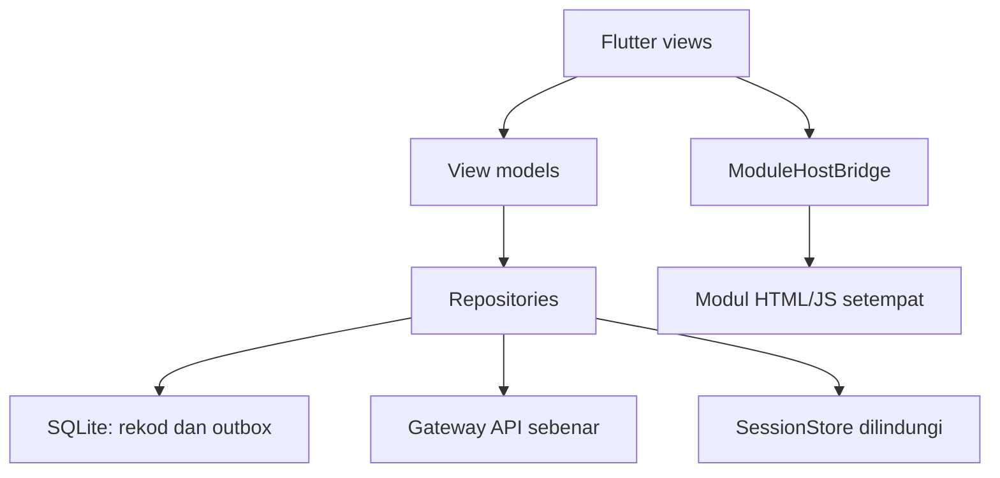

# Seni bina cadangan dan keputusan teknikal

Status: cadangan untuk pelaksanaan akan datang. Flutter ialah kehendak pengguna;
pilihan hibrid, Android dahulu dan susunan folder ialah cadangan penulis.

## ADR-001 — Flutter hibrid dengan modul setempat

| Pilihan | Faedah | Kos / keputusan |
|---|---|---|
| Flutter penuh termasuk renderer/parser | Satu runtime untuk semua UI dan matematik | Port besar dengan risiko geometri, unjuran dan parser; hanya selepas parity dibuktikan |
| Flutter shell + modul geometri WebView | Guna renderer/math sebenar; UI akaun/kelas boleh diseragamkan | Perlu bridge, lifecycle dan ujian WebView; **cadangan awal** |
| Seluruh website di WebView | Spike paling cepat dan sedikit perubahan domain | UX mudah alih dan ownership sesi mudah bercampur; bukan sasaran akhir48 paparan native |

Syor: native Flutter untuk shell, preferences, akaun/kelas dan permainan.
Modul geometri dibundel sebagai aset HTML/JS setempat yang dibina daripada
release Digital yang dipin. Enjin solo Dart hanya diterima selepas golden
fixtures sepadan dengan JavaScript. Duel/kelas sentiasa menggunakan projection
pelayan. Tiada enjin pemarkahan kedua untuk mod dalam talian.

## ADR-002 — Satu pemilik bagi setiap jenis data



- View membentangkan state dan mengirim tindakan. View model mengatur keadaan
  paparan tanpa menulis SQL atau mengira markah online.
- Repository memilih sumber setempat/remote dan mengawal perubahan. Service
  mengendalikan satu transport atau platform plugin.
- PreferencesRepository ialah pemilik bahasa, tema, teks, kontras, motion dan audio.
  WebView menerima snapshot preferences; ia tidak mencipta store kedua.
- AuthRepository ialah pemilik actor/session/epoch. Tiada token dalam objek UI,
  state serializable umum, rekod latihan atau mesej modul.
- ModuleRepository menyimpan empat refleksi. Draf studio dan checkpoint solo
  bukan rekod refleksi dan tidak dianggap sync rentas peranti.

## ADR-003 — Struktur feature dengan asas bersama

Lokasi yang **dicadangkan**, bukan fail yang sudah wujud:

```text
apps/geomath_flutter/
  lib/main.dart
  lib/app/app.dart
  lib/app/app_router.dart
  lib/core/design/geomath_theme.dart
  lib/core/design/face_palette.dart
  lib/core/widgets/                   # shell, field, dialog, notice, status
  lib/core/session/                   # ActorBinding, AuthRepository, SessionStore
  lib/core/storage/                   # database, schema migrations, outbox
  lib/core/network/                   # transport, policy, typed failure
  lib/features/home/
  lib/features/learning/              # ModuleHostBridge, module views/records
  lib/features/solo/                  # Dart engine, store, score repository
  lib/features/auth/
  lib/features/classroom/
  lib/features/duel/
  lib/features/profile/
  lib/features/preferences/
  lib/features/help/
  assets/module/                     # build canonical, bukan screenshot UI
  assets/contracts/                  # bank/ruleset/source hash manifest
  test/
  integration_test/
```

Gunakan Material 3 dan mekanisme state SDK seperti ChangeNotifier/ValueNotifier
untuk permulaan. Flutter Router mengendalikan route typed. State-management
package tambahan hanya jika keperluan nyata memerlukannya; semua feature mesti
mengikut satu pendekatan yang sama.

Dependency candidate: `webview_flutter`, `supabase_flutter`, `sqflite` dan
`flutter_secure_storage`. Semak API/keperluan platform semasa kickoff, pilih
versi tepat, commit lockfile dan rekod sebab perubahan. Versi pada laman rasmi
semasa dokumen ditulis bukan pin wajib untuk pembangunan tahun hadapan.

## ADR-004 — Jambatan native bukan pengganti protocol sedia ada

Cadangan `nativeBridgeVersion:1` hanyalah envelope **baharu untuk app**, bukan
pertukaran module progress protocol 1 atau settings channel version 1.

1. Flutter memuat wrapper HTML setempat yang dipercayai. Wrapper memuat modul
   canonical dan mengekalkan pemeriksaan `event.source`, instanceId dan sesi.
2. Envelope native menerima command allowlist: ready, progress, open-settings,
   open-help dan request-navigation yang telah divalidasi. Maklumat dimensi
   atau draf hanya melalui kontrak khusus yang ditentukan selepas audit.
3. Flutter menetapkan instance/session nonce, semakan schema dan had envelope
   cadangan64KiB. Payload refleksi tetap terikat had canonical240/600/600.
4. Actor sebenar diambil daripada native AuthRepository. JS tidak memilih owner,
   meminta RPC arbitrari atau menerima credential.
5. Navigation WebView dikunci kepada aset dipercayai. Pautan rujukan luar dibuka
   melalui tindakan native yang dibenarkan. Controller URL, main-frame context
   dan wrapper origin disemak; jangan percaya medan `origin` yang dikirim JS.
6. Logout/account switch membatalkan epoch lama, menutup instance modul dan
   membersihkan draf mengikut kontrak. Respons lewat diabaikan.

Existing progress message: type `geodecoder:module-progress`, `protocol:1`,
`session`, `activity`, `stage`, `prediction`, `result`, `explanation`, `completed`.
Settings menggunakan `channel`, `version:1`, `instanceId`, `type`, `settings`;
jangan campurkan kedua-dua nonce atau format. Wrapper adapter perlu diuji
terhadap source `module-settings.mjs`, `module-frame.mjs`, `module-progress.mjs`.

## ADR-005 — Lifecycle dan aset

App binary mempunyai manifest hash bagi semua aset pembelajaran. Jangan
mengambil JS raw daripada branch bergerak ketika runtime. Update kandungan
menggunakan release yang disahkan, pemeriksaan schema/hash dan pengaktifan
atomik apabila tiada aktiviti yang akan terganggu.

Native lifecycle menghentikan audio/auto-rotation ketika background. Solo
mengekalkan clock/checkpoint/review baki; Duel/kelas mengekalkan masa pelayan
dan resync apabila foreground. Route switch tidak memusnahkan draf secara
rawak; account switch ialah sempadan pemusnahan yang nyata.

WebView bukan hanya gambar. Ia mesti memberi putar/cubit, lipat, pilih muka,
lukisan, Undo, input dan semakan sebenar. Tiada janji widget WebView rasmi
akan berfungsi sama pada Windows/Linux/web tanpa adapter dan ujian tambahan.

## Pintu keputusan sebelum implementasi

Sahkan Android-first dan hibrid semasa kickoff, bukan semasa menyediakan pakej
ini. Jika Flutter penuh dipilih, tambah subprojek port renderer/parser dan
golden geometry sebelum membina semua skrin. Jangan menganggap perubahan
pilihan ini membenarkan pengurangan11 model atau penukaran formula.
