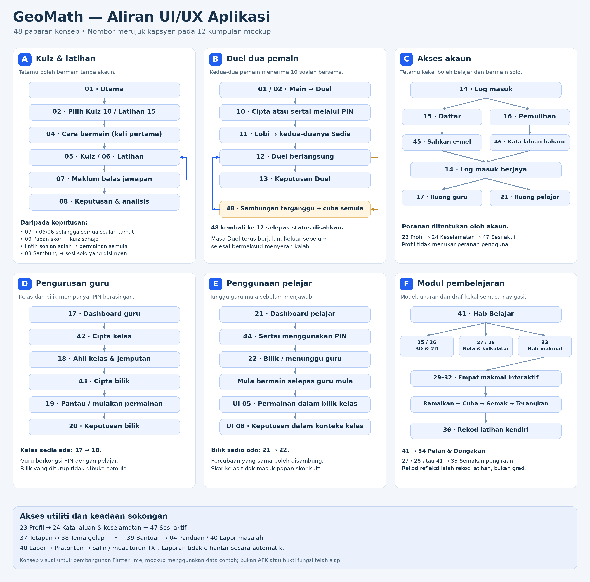

# GeoMath App — Pakej Persediaan Pembangunan

Versi dokumen **1.0.0** · **4 November 2026, Asia/Kuala_Lumpur**.
Pemilik projek: **Ijamm / NORHIZAM BIN AHMAD SHAFFE**.
Sumber produk: [unDead41/geodecoder](https://github.com/unDead41/geodecoder).

Pakej ini menyimpan keputusan reka bentuk, SOR dan pelan untuk membangunkan
GeoMath sebagai app Flutter pada masa hadapan. Ia mengandungi **48 paparan
mockup dalam 12 gambar**, skema warna muka bongkah terkini dan peta aliran.
Ia belum mengandungi projek Flutter, APK, migration yang telah dipasang atau
bukti fungsi app telah berjalan.

## Mula membaca di sini

| Fail | Kegunaan |
|---|---|
| [SOR.md](SOR.md) | Keperluan utama, sempadan produk dan syarat penerimaan |
| [SOURCES_AND_STATUS.md](SOURCES_AND_STATUS.md) | SHA sumber, status branch, sumber rasmi dan pembetulan mockup |
| [ARCHITECTURE.md](ARCHITECTURE.md) | Cadangan Flutter hibrid, pemilik data dan jambatan modul |
| [UX_CONTRACT.md](UX_CONTRACT.md) | Aliran, tindakan, keadaan ralat dan pengesahan pengguna |
| [DESIGN_SYSTEM.md](DESIGN_SYSTEM.md) | Komponen boleh guna semula, warna muka dan kebolehcapaian |
| [SCREEN_CATALOG.md](SCREEN_CATALOG.md) | Pemetaan semua 48 paparan, route cadangan dan 16 keadaan tambahan |
| [DATA_BACKEND_CONTRACT.md](DATA_BACKEND_CONTRACT.md) | Auth, kelas, CRUD, Duel, payload dan kuasa pelayan |
| [OFFLINE_SYNC.md](OFFLINE_SYNC.md) | Simpanan setempat, outbox dan penyelarasan yang dibenarkan |
| [Pelan pelaksanaan](docs/superpowers/plans/2026-11-04-geomath-flutter.md) | Tugasan berurutan dengan fail, antara muka dan pengesahan |
| [TEST_PLAN.md](TEST_PLAN.md) | Ujian domain, bridge, keselamatan, telefon dan matriks SOR |
| [AGENTS.md](AGENTS.md) | Arahan kerja untuk pembangun atau pembantu AI pada masa depan |
| [RESUME_PROMPT.md](RESUME_PROMPT.md) | Prompt yang boleh disalin apabila bersedia memulakan app |
| [HANDOFF_TEMPLATE.md](HANDOFF_TEMPLATE.md) | Format rekod kerja, SHA, ujian, batasan dan langkah sambung |
| [VALIDATION.md](VALIDATION.md) | Semakan sebenar terhadap pakej dokumen ini |

## Cadangan asas — belum keputusan pelaksanaan muktamad

Platform Flutter telah diminta pengguna. Cadangan penulis ialah **Android dahulu**,
Flutter untuk navigasi, akaun, kelas dan permainan; modul geometri JavaScript
setempat melalui WebView supaya renderer, formula dan parser sedia ada boleh
diguna semula. Enjin kuiz solo yang dipindahkan ke Dart mesti lulus perbandingan
dengan enjin JavaScript canonical. iOS menyusul selepas ujian platform.
Lihat ADR dalam ARCHITECTURE sebelum memilih Flutter penuh atau hibrid.

Satu perubahan penting: source permainan mempunyai **Kubus, Kuboid, Piramid,
Silinder dan Kon**. Beberapa imej menunjukkan Prisma sebagai pilihan permainan;
itu mesti dibetulkan ketika membina UI. Prisma masih sah dalam katalog
**11 bongkah pembelajaran**. Gambar juga tidak menjadi sumber formula atau
garis unjuran tepat. Semua pengecualian disenaraikan dalam SOURCES_AND_STATUS.

## Bila hendak menyambung

1. Baca SOR dan status sumber. Semak semula remote kerana SHA di sini ialah
   rekod semasa dokumen ditulis, bukan arahan menggunakan kod lama selama-lamanya.
2. Selaraskan dahulu kerja offline, CRUD, scaling dan UI pada asas integrasi yang
   disahkan. Kehadiran branch atau SQL dalam Git bukan bukti ia aktif di production.
3. Salin pakej ini ke `docs/geomath-app/` dalam checkout sendiri jika mahu.
   `AGENTS.md` di sini untuk skop app; jangan menimpa AGENTS akar repository.
4. Gunakan RESUME_PROMPT. Mulakan dengan satu spike modul offline pada telefon,
   kemudian ikuti pelan berperingkat. App boleh bermula dengan Belajar sebelum
   semua fungsi kelas dan Duel disiapkan.
5. Kekalkan branch kerja app tersendiri. Tiada push, merge atau deployment
   dilaksanakan oleh pakej dokumentasi ini.

## Rujukan visual terkini

| Kumpulan | Paparan | Gambar |
|---|---|---|
| 01 | 01–04 · Mula dan panduan | [Buka](assets/mockups/01-start-and-guide.png) |
| 02 | 05–08 · Permainan dan maklum balas | [Buka](assets/mockups/02-game-and-feedback.png) |
| 03 | 09–12 · Papan skor dan Duel | [Buka](assets/mockups/03-scoreboard-and-duel.png) |
| 04 | 13–16 · Keputusan Duel dan akses akaun | [Buka](assets/mockups/04-account-and-duel-result.png) |
| 05 | 17–20 · Ruang guru | [Buka](assets/mockups/05-teacher-workspace.png) |
| 06 | 21–24 · Pelajar dan profil | [Buka](assets/mockups/06-student-and-profile.png) |
| 07 | 25–28 · Teroka, pandangan, nota, kalkulator | [Buka](assets/mockups/07-explore-notes-calculator.png) |
| 08 | 29–32 · Empat makmal | [Buka](assets/mockups/08-interactive-labs.png) |
| 09 | 33–36 · Studio dan rekod | [Buka](assets/mockups/09-studio-and-progress.png) |
| 10 | 37–40 · Tetapan dan bantuan | [Buka](assets/mockups/10-settings-and-support.png) |
| 11 | 41–44 · Hab dan pengurusan kelas | [Buka](assets/mockups/11-hub-and-class-management.png) |
| 12 | 45–48 · Pengesahan, sesi, sambungan | [Buka](assets/mockups/12-auth-sessions-connection.png) |

Paparan 04 dan 05 menggunakan gambar terdahulu kerana tiada model pembelajaran
bermuka berwarna yang perlu ditukar. Sepuluh kumpulan lain menggunakan versi
warna muka terkini, termasuk pembetulan akhir kumpulan 08, 09 dan 10.

## Cara menyemak pakej

Jalankan `python tools/validate_docs.py` dari folder pakej selepas diekstrak.
Semakan ini mengesahkan rujukan fail, 48 ID paparan, token warna dan hash aset.
Ia tidak menjalankan atau mengesahkan aplikasi Flutter.
